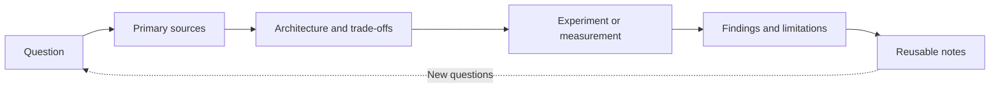
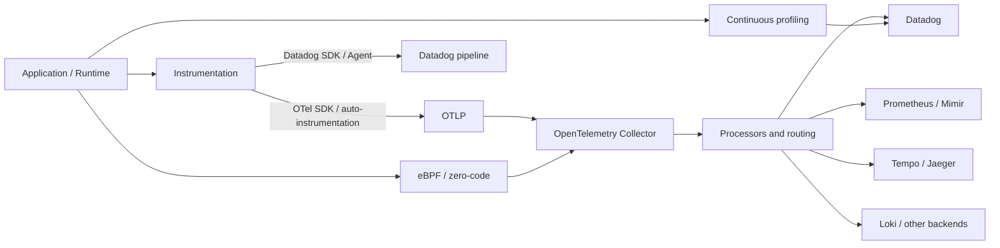
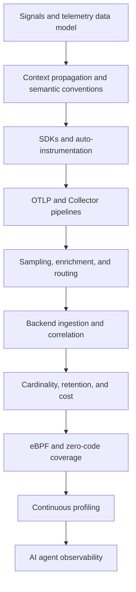

# Observability Fieldnotes

A personal research notebook for understanding observability systems through source-backed research, architectural analysis, and reproducible experiments.

The focus is on **OpenTelemetry**, **Datadog**, and the engineering systems around telemetry collection, processing, storage, analysis, and cost control. The goal is to build durable technical understanding—not just collect links or summarize documentation.

## Research approach

Research typically moves through this cycle:



- **Start with a question.** Make the problem or design decision explicit.
- **Prefer primary evidence.** Use official specifications, source code, technical documentation, and measured results where available.
- **Separate fact from interpretation.** Record assumptions, version-specific behavior, uncertainty, and limitations.
- **Use experiments when useful.** Keep configurations and observations reproducible; screenshots alone are not evidence.
- **Compare designs by trade-offs.** Explain operational impact, performance, correctness, complexity, and cost.

## Scope

| Research area | Topics |
|---|---|
| OpenTelemetry | API and SDK, auto-instrumentation, OTLP, Collector, semantic conventions, context propagation |
| Distributed tracing | Span models, trace pipelines, sampling, service topology, trace-to-metric relationships |
| Metrics and logs | Cardinality, aggregation, correlation, storage and query patterns |
| Datadog interoperability | Datadog SDK and Agent, DDOT, upstream Collector, ingestion and retention behavior |
| Telemetry economics | Volume, cost attribution, retention, sampling, cardinality control |
| Instrumentation | eBPF, zero-code instrumentation, Kubernetes injection and coverage boundaries |
| Continuous profiling | Profiles and their correlation with traces and other signals |
| AI and agent observability | Workflow and tool spans, token and cost metrics, evaluation, failure analysis |
| Governance | PII handling, tenancy, routing, schema evolution and policy enforcement |

The scope can evolve as new questions emerge. Vendor-specific details should be labeled explicitly rather than presented as universal behavior.

## System overview

This diagram is a conceptual map of common telemetry paths, not a claim that every deployment uses every component.



## Repository structure

```text
.
├── docs/
│   ├── roadmap.md
│   ├── otel/
│   ├── datadog/
│   ├── comparisons/
│   └── frontier/
├── labs/
│   ├── otel-collector/
│   └── otel-to-datadog/
├── research/
│   └── template.md
├── .github/
│   ├── ISSUE_TEMPLATE/
│   └── pull_request_template.md
└── README.md
```

- `docs/` holds durable explanations, architecture notes, and comparisons.
- `labs/` holds reproducible experiments and configurations.
- `research/` holds research records and templates.

## Suggested learning path



Use this as a map, not a mandatory sequence. Follow the research question that has the clearest learning value.

## Working conventions

1. One focused research question per Issue.
2. For each experiment, record the environment, versions, configuration, hypothesis, observations, and limitations.
3. Cite the primary source for specifications and product behavior; include access dates when behavior may change.
4. Distinguish documented facts, measured results, and personal interpretation.
5. State the scope of conclusions, especially where results depend on versions or vendors.
6. Never commit API keys, tokens, or other secrets.

## References

### OpenTelemetry
- [Documentation](https://opentelemetry.io/docs/)
- [Specification](https://opentelemetry.io/docs/specs/otel/)
- [OTLP specification](https://opentelemetry.io/docs/specs/otlp/)
- [Collector documentation](https://opentelemetry.io/docs/collector/)
- [Zero-code instrumentation](https://opentelemetry.io/docs/zero-code/)

### Datadog
- [OpenTelemetry integration](https://docs.datadoghq.com/opentelemetry/)
- [OpenTelemetry getting started](https://docs.datadoghq.com/opentelemetry/getting_started/)
- [Datadog Distribution of the OpenTelemetry Collector](https://docs.datadoghq.com/opentelemetry/setup/ddot_collector/)
- [LLM Observability](https://docs.datadoghq.com/llm_observability/)

## Initial research questions

- [ ] Build a minimal OTLP traces, metrics, and logs pipeline with the OpenTelemetry Collector.
- [ ] Compare OTel SDK → upstream Collector → Datadog with Datadog SDK → Agent/DDOT.
- [ ] Evaluate head sampling and tail sampling under error-heavy traffic.
- [ ] Measure high-cardinality metric impact and mitigation techniques.
- [ ] Prototype eBPF or zero-code instrumentation and document coverage gaps.
- [ ] Trace a small LLM/agent workflow using OpenTelemetry GenAI conventions and Datadog.

---

**Observability Fieldnotes** is a personal learning and research repository. Findings should be treated as scoped to their cited sources, tested versions, and recorded assumptions.
