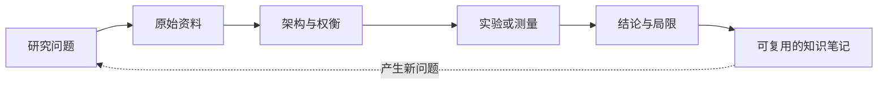
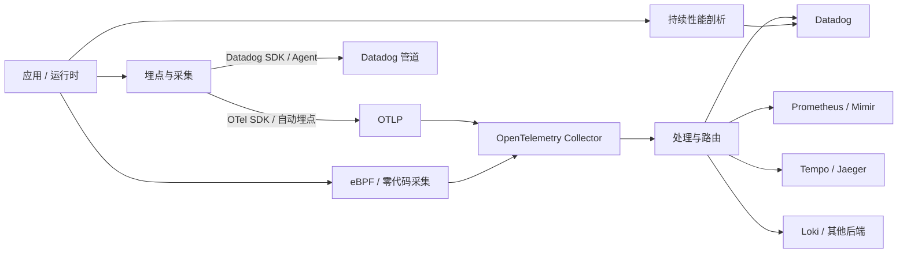
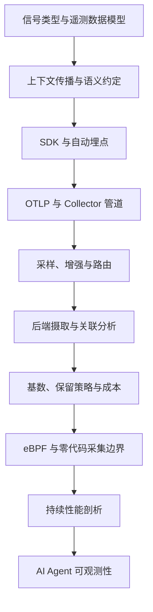

# Observability Fieldnotes

一个用于个人学习与技术研究的可观测性笔记库，通过**原始资料、架构分析和可复现实验**，持续理解可观测性系统的设计与实现。

研究重点包括 **OpenTelemetry、Datadog**，以及遥测数据的采集、处理、存储、分析和成本控制。目标是形成可复用、可追溯的技术理解，而不只是收集链接或转述文档。

## 研究方法

研究通常沿着以下过程推进：



- **从明确的问题开始。** 说明要理解的机制，或需要做出的工程决策。
- **优先使用一手证据。** 尽可能参考官方规范、源代码、技术文档和实际测量结果。
- **区分事实与解释。** 记录假设、版本差异、不确定性和结论边界。
- **在适合的场景中做实验。** 保留可复现的配置和观测结果；截图本身不能替代证据。
- **通过权衡比较设计。** 分析运维影响、性能、正确性、复杂度和成本。

## 研究范围

| 研究方向 | 关注内容 |
|---|---|
| OpenTelemetry | API 与 SDK、自动埋点、OTLP、Collector、语义约定、上下文传播 |
| 分布式追踪 | Span 模型、Trace Pipeline、采样、服务拓扑、Trace 与指标的关联 |
| 指标与日志 | 基数、聚合、关联分析、存储与查询模式 |
| Datadog 与 OTel 互操作 | Datadog SDK 与 Agent、DDOT、上游 Collector、数据摄取与保留行为 |
| 遥测经济性 | 数据量、成本归因、保留策略、采样、基数控制 |
| 埋点与采集 | eBPF、零代码埋点、Kubernetes 注入及覆盖边界 |
| 持续性能剖析 | Profile，以及它与 Trace 和其他信号的关联 |
| AI 与 Agent 可观测性 | 工作流和工具 Span、Token 与成本指标、评估、故障分析 |
| 数据治理 | PII 处理、多租户、路由、Schema 演进与策略控制 |

研究范围会随着问题演进。厂商特有的行为应明确标注，不能直接当作通用规律。

## 系统概览

下图用于说明常见遥测链路，不代表每种部署都包含图中的全部组件。



## 仓库结构

```text
.
├── docs/
│   ├── roadmap.md
│   ├── otel/
│   ├── datadog/
│   ├── comparisons/
│   └── frontier/
├── labs/
│   ├── otel-collector/
│   └── otel-to-datadog/
├── research/
│   └── template.md
├── .github/
│   ├── ISSUE_TEMPLATE/
│   └── pull_request_template.md
└── README.md
```

- `docs/`：沉淀可长期复用的技术说明、架构分析和方案对比。
- `labs/`：保存可复现的实验、配置和测量过程。
- `research/`：保存研究记录与模板。

## 建议学习路径



这是一张知识地图，不是必须按顺序完成的课程。优先研究最有学习价值的问题即可。

## 研究约定

1. 每个 Issue 聚焦一个明确的研究问题。
2. 每次实验记录环境、版本、配置、假设、观测结果和局限。
3. 规范与产品行为应引用原始资料；对可能变化的行为，记录查阅日期。
4. 明确区分文档事实、实测结果和个人判断。
5. 标注结论的适用范围，尤其是依赖特定版本或厂商实现的结论。
6. 不提交 API Key、Token 或其他敏感凭据。

## 参考资料

### OpenTelemetry

- [官方文档](https://opentelemetry.io/docs/)
- [规范](https://opentelemetry.io/docs/specs/otel/)
- [OTLP 规范](https://opentelemetry.io/docs/specs/otlp/)
- [Collector 文档](https://opentelemetry.io/docs/collector/)
- [零代码埋点](https://opentelemetry.io/docs/zero-code/)

### Datadog

- [OpenTelemetry 集成](https://docs.datadoghq.com/opentelemetry/)
- [OpenTelemetry 入门](https://docs.datadoghq.com/opentelemetry/getting_started/)
- [Datadog 发行版 OpenTelemetry Collector（DDOT）](https://docs.datadoghq.com/opentelemetry/setup/ddot_collector/)
- [LLM Observability](https://docs.datadoghq.com/llm_observability/)

## 初始研究问题

- [ ] 使用 OpenTelemetry Collector 搭建最小化的 OTLP Trace、Metrics、Logs 管道。
- [ ] 对比 OTel SDK → 上游 Collector → Datadog 与 Datadog SDK → Agent/DDOT。
- [ ] 在错误密集的流量场景下评估头部采样与尾部采样。
- [ ] 测量高基数指标的影响及其治理方法。
- [ ] 验证 eBPF 或零代码埋点，并记录其覆盖范围和盲区。
- [ ] 使用 OpenTelemetry GenAI 语义约定和 Datadog 跟踪一个小型 LLM/Agent 工作流。

---

**Observability Fieldnotes** 是一个个人学习与技术研究仓库。所有结论都应结合引用来源、测试版本和记录的假设理解。
