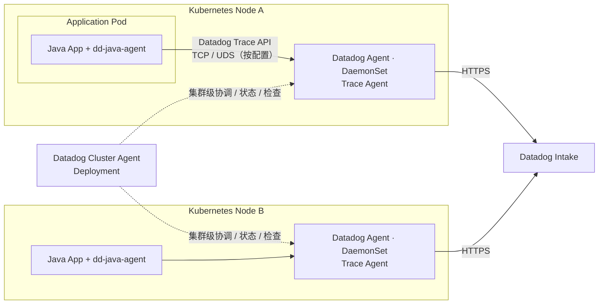
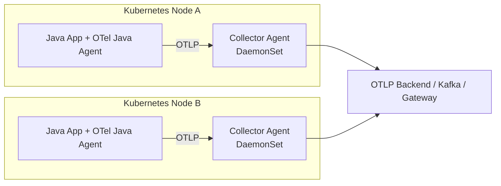
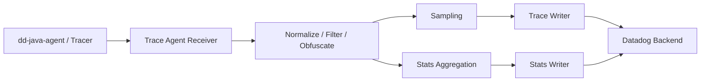
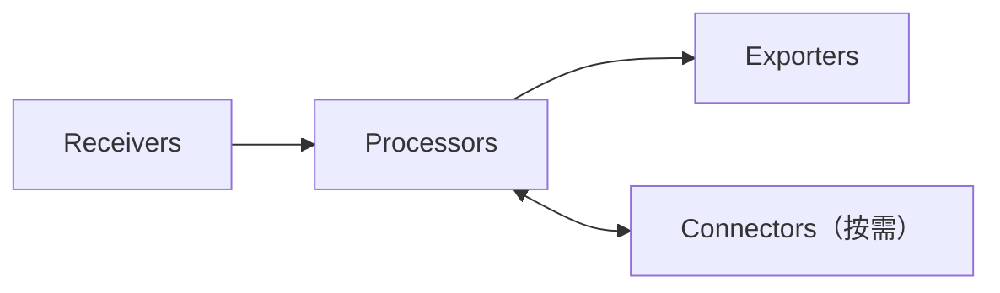
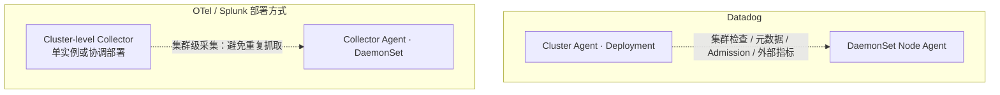
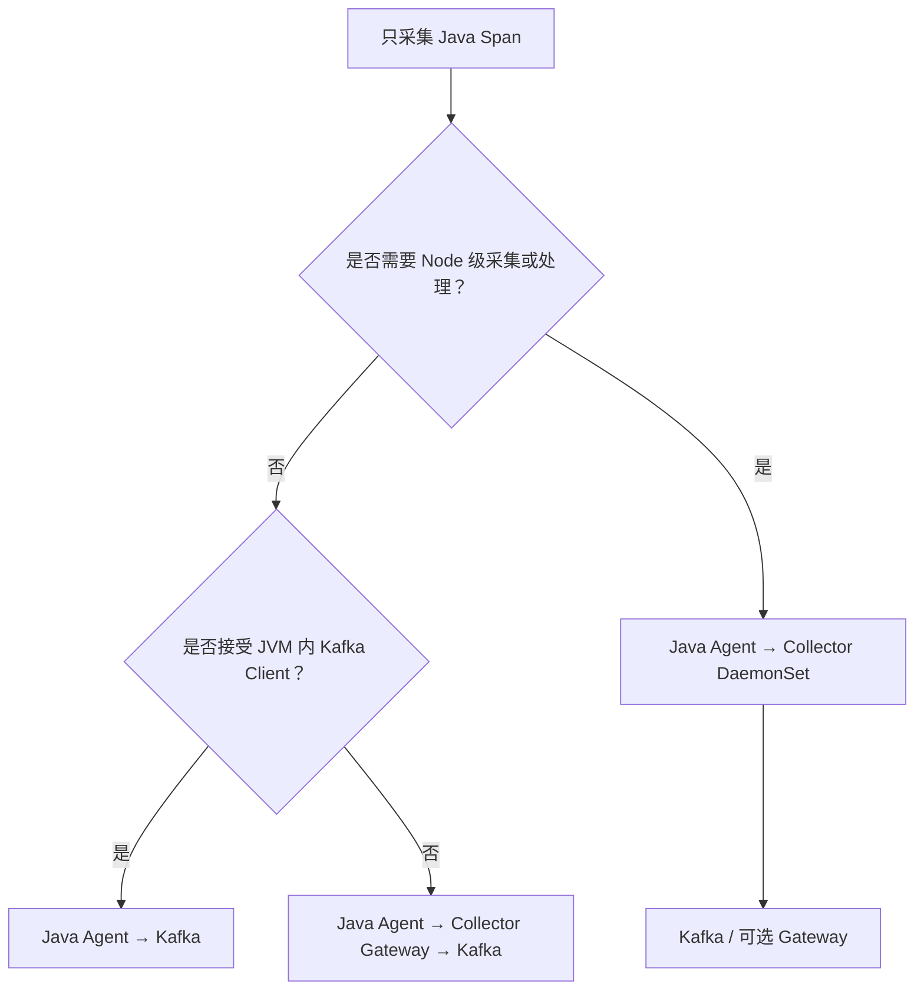

# Datadog Agent 与 OpenTelemetry Collector Agent（DaemonSet）部署架构对比

> 调研日期：2026-10-25  
> 研究范围：Kubernetes **Node 级采集部署**及其 Trace 数据路径；重点是 Datadog Agent DaemonSet 与 OTel Collector Agent 模式的可比性。  
> 证据：Datadog / OpenTelemetry 官方文档与公开源码。本文未执行 Helm 部署、运行时测试或性能测量；以下“工程判断”不代表官方架构要求。

## 1. 研究问题与结论

**问题**：把 Datadog Agent 理解为“类似 OpenTelemetry Collector Node Agent 的 DaemonSet 采集层”，是否准确？

**结论**：在 **Kubernetes 工作负载、每 Node 采集位置、应用 → 本地采集层 → 远端后端** 这个部署层面，可以这样类比；但不应据此推断二者协议、运行时组件、采样和统计语义相同。

- Datadog 官方 Helm Chart 默认通过 **DaemonSet** 将 Node Agent 部署到每个 Node，并通常同时部署独立的 **Cluster Agent Deployment**。
- OpenTelemetry Collector 官方 Agent 模式允许在应用旁边或同一主机运行 Collector，在 Kubernetes 上常通过 **DaemonSet** 实现。其 Gateway 是另一种**可选角色**，并非 Agent 模式必需的第二层。
- Datadog Agent 包含面向 Datadog 平台的数据摄取路径；其中 **Trace Agent** 具有接收、标准化、过滤、混淆、采样、APM Stats 聚合与发送能力。OTel Collector 则将接收、处理、导出组织为可配置组件管道，能通过相应组件实现部分相似功能，但默认功能和语义不等价。
- Datadog **Cluster Agent** 与 OTel / Splunk 的集群级 Collector **仅在部署位置上相似**。前者还承担集群检查调度、Admission Controller、外部指标等产品能力，不能一一映射为“Cluster Receiver”。
- 对仅需 **Java Span → Kafka** 的系统，这一对比**不意味着必须引入 Node DaemonSet**：可选择 Gateway-only 或 JVM 直接 Kafka Exporter，二者的运维成本与 JVM 内依赖不同。

## 2. 部署拓扑：相同的 Node 级角色

### 2.1 Datadog 典型 Kubernetes APM 路径

**注意网络寻址**：Java 应用 Pod 与 DaemonSet Agent 是不同 Pod。应用 Pod 中的 `localhost:8126` 并不自动指向节点上的 Datadog Agent。Datadog 可配置 Node IP、Unix Domain Socket 挂载等入口；其官方 Trace API 示例中的 `localhost:8126` 仅适用于接收端确实位于该网络命名空间的情况。跨 Pod 配置应核对实际接入模式和网络策略。

部署职责：

1. `dd-java-agent` 在 JVM 内完成埋点、Trace 生成与发送。
2. Node Datadog Agent 作为 DaemonSet Pod 运行；其 Trace Agent 接收 APM 数据，处理后转发至 Datadog Intake。
3. Cluster Agent 是**独立的 Deployment**，主要负责集群级能力，而不是所有 JVM Trace 的强制中转层。

一手证据：[Datadog Kubernetes 安装](https://docs.datadoghq.com/containers/kubernetes/) · [Datadog Helm Chart README](https://github.com/DataDog/helm-charts/blob/main/charts/datadog/README.md) · [Datadog Trace Agent 源码说明](https://github.com/DataDog/datadog-agent/blob/main/pkg/trace/README.md)。

### 2.2 OpenTelemetry Collector Agent 模式

- OTel Java Agent 运行于业务 JVM，Collector Agent 运行在独立 Pod / 进程。
- Collector Agent 通过 Receiver 接收 OTLP 或采集主机、容器指标和文件日志。
- DaemonSet 解决**节点级部署**，不等于每个应用 Pod 都注入 Collector Sidecar。
- 出口可以是 Backend，也可以是独立 Gateway；**Gateway 非必需**。

官方依据：[Collector Agent 部署模式](https://opentelemetry.io/docs/collector/deploy/agent/) · [Gateway 模式](https://opentelemetry.io/docs/collector/deploy/gateway/)。

### 2.3 拓扑对应关系

| 比较项 | Datadog Agent | OTel Collector Agent |
|---|---|---|
| Node 级工作负载 | DaemonSet（官方 Helm 默认） | DaemonSet（官方 Agent 模式的一种常见实现） |
| 每节点实例 | 常规每 Node 一个 Agent Pod；受调度规则影响 | 常规每 Node 一个 Collector Pod；受调度规则影响 |
| JVM 内组件 | `dd-java-agent` / Datadog Tracer | `opentelemetry-javaagent` / OTel SDK |
| 接收方式 | Datadog Trace API（并支持其他入口） | 依启用的 Receiver，通常 OTLP gRPC/HTTP |
| 发送目标 | Datadog Intake | 按 Exporter 可发 OTLP、Kafka 等 |
| 集群级工作负载 | Datadog Cluster Agent Deployment | 可单独部署集群级 Collector；非必须 |
| 集中 Gateway | 非默认架构中的必经层 | 官方可选部署模式 |
| 管理方式 | Datadog Helm Chart / Operator | OTel Collector Helm Chart / Operator / 原生 Manifest |

“对应”仅表示**部署角色**；Datadog Agent ≠ OTel Collector 二进制程序，也不等于协议兼容。

## 3. Trace 处理管道：部署相似，职责不同

### 3.1 Datadog Trace Agent

Datadog 仓库 `pkg/trace/README.md` 说明了 Trace Agent 的核心流程：

主要行为及其边界：

- **Receiver**：接收 Datadog APM SDK 发送的 Trace，并通过响应机制向客户端反馈部分动态采样率。
- **处理**：字段规范化、Tag 补全、敏感数据混淆、过滤、截断。
- **采样**：包含 Priority / Errors / Rare 等策略，具体启用情况与版本和配置有关；并非每一种策略都默认启用。
- **统计**：Stats 的计算可能由 Tracer 提前完成并上传，也可能由 Agent 内的 Concentrator 对已接收的 Span 聚合；**不能笼统说所有 RED 指标必然由 Agent 全部重新计算**。
- **Writer**：分别处理采样后的 Trace 数据和聚合 Stats，并将其发送给 Datadog 后端。

从部署上看，这些能力位于 DaemonSet 中；从实现上看，它是 Datadog 特定的 Trace Pipeline，不只是透明网络转发。

源码：[DataDog/datadog-agent/pkg/trace](https://github.com/DataDog/datadog-agent/tree/main/pkg/trace) · [Trace Agent README](https://github.com/DataDog/datadog-agent/blob/main/pkg/trace/README.md)。

### 3.2 OpenTelemetry Collector

Collector 的职责取决于**实际组装的 pipeline**，不是由 DaemonSet 这一 Kubernetes 资源类型决定。示例：

- OTLP Receiver + Batch Processor + OTLP Exporter：收集并转发应用 Trace。
- Filelog Receiver / Hostmetrics Receiver：采集节点局部数据。
- Tail Sampling Processor：需要同 Trace 数据汇聚和状态管理。
- Kafka Exporter：从 Collector 写入 Kafka；是否可用取决于所选 Collector 发行版和版本。

因此二者功能并非简单的“一一对应”。例如 OTel 的 `spanmetrics` Connector 可派生指标，但其分组、维度及采样前后语义需要按实现配置验证，不能默认等同 Datadog APM Stats。

官方参考：[Collector 配置](https://opentelemetry.io/docs/collector/configuration/) · [Collector 组件目录](https://opentelemetry.io/docs/collector/components/)。

## 4. 集群级组件：Datadog Cluster Agent 不能直接映射为 Cluster Receiver

两者相似处：都将不适合在每个 Node 重复执行的集群相关功能放在独立工作负载。

主要区别：

- **Datadog Cluster Agent** 是特定产品组件，除集群指标与状态外还提供调度、Admission Controller 等能力。
- **Splunk Chart 的 Cluster Receiver** 是独立 Collector 工作负载，重点是集群级采集与对应的出口配置。
- **纯 OTel 部署**可使用独立 Collector 来采集 Kubernetes API / cluster 资源，不要求存在一个与 Datadog Cluster Agent 结构等同的产品控制面。

不要仅按名称把三者视为替代品。

依据：[Datadog Cluster Agent 官方文档](https://docs.datadoghq.com/agent/kubernetes/cluster/) · [Datadog Cluster Agent Deployment Manifest](https://github.com/DataDog/datadog-agent/blob/main/Dockerfiles/manifests/cluster-agent/cluster-agent-deployment.yaml) · [Splunk Collector Helm Chart](https://github.com/signalfx/splunk-otel-collector-chart)。

## 5. 部署实践与运维约束

| 维度 | Datadog DaemonSet | OTel DaemonSet |
|---|---|---|
| 节点覆盖 | DaemonSet 控制；注意 Taint、Toleration、Node Selector | 相同的 Kubernetes 调度约束 |
| 应用到 Agent 寻址 | Node IP / 挂载 UDS 等需明确配置 | Node IP / 服务发现 / localhost 仅同网络空间可用 |
| Agent 生命周期 | Datadog 发布升级与配置管理 | Collector 版本、Chart / Operator 管理 |
| 出口凭据 | Datadog API Key 等由采集层管理 | Exporter 凭据取决于 Backend |
| 采样和统计 | Datadog 的 Trace Agent 管道与客户端配合 | 按选定 Processor、Connector 和后端语义组合 |
| 故障域 | 节点 Agent 故障影响该节点应用上报；出口/后端另有故障域 | 节点 Collector 故障类似；Gateway 存在时还有集中层故障域 |
| 端到端交付 | 需要检查缓冲、重试和后端行为 | 需要检查 SDK + Collector 队列与 Exporter 行为 |

**部署方式本身不提供零丢失承诺。** 两种方案都需实际压测节点重启、Agent 不可用、出口拥塞和后端不可用时的丢弃与恢复行为。

特别是：`dd-java-agent` 与 Datadog Node Agent 通常不在同一个 Pod；不能把“节点本地 Agent”直接等价为所有应用均能访问的 `localhost` 服务。

## 6. 对 Spanloom 的架构取舍

本项目当前问题是 **只上传 Span，希望减少部署 Collector 组件**。Datadog 的 DaemonSet 方案说明了“Node 级采集层”的一种可运维路径，但它不构成 Spanloom 必须复制的前提。

三种拓扑：

| 方案 | 需要部署 Collector？ | 代价 |
|---|---|---|
| Java Agent → Kafka | **不需要** | 每个 JVM 引入 Kafka Client、连接、Producer 缓冲与凭据；需集成 KafkaSpanExporter |
| Java Agent → Gateway → Kafka | 需要 Gateway Deployment | 复用标准 OTLP Exporter；额外运行集中接收服务 |
| Java Agent → Node Collector → Kafka / Gateway | 需要 DaemonSet | 适于节点采集和本地隔离；增加 Node 级运行与配置成本 |

**工程判断**：如果减少部署组件是唯一主要目标，Java Agent 直连 Kafka 方案成立；应优先评估已有 [OpenTelemetry Java Contrib KafkaSpanExporter](https://github.com/open-telemetry/opentelemetry-java-contrib/tree/main/kafka-exporter) 的实际 Java 版本兼容性、Agent ClassLoader 隔离、导出成功语义以及 Kafka 故障下对业务 JVM 的影响。不要把 Datadog 的 Node Agent 功能原样塞入 JVM。

当需要节点指标、容器日志、节点本地采集、统一出口和节点级数据治理时，再引入 DaemonSet Collector；当仅需统一 Kafka 出口与保留 OTLP 协议时，可直接选择 Gateway-only。

## 7. 尚待验证的问题

- [ ] 用固定 Datadog Helm Chart 版本执行 `helm template`，核对 Node Agent、Cluster Agent、Trace Agent 实际容器及 Service/Socket 暴露方式。
- [ ] 在 Kubernetes 验证不同 Pod 中 Datadog SDK 到 Node Agent 的 Node IP / UDS 访问方式，确认是否存在跨 Node 路由。
- [ ] 固定 OTel Collector Contrib 与 Datadog Agent 版本，对比 Node 重启、Kafka/Intake 不可用时的失败语义、缓冲和指标。
- [ ] 用真实负载对比 Gateway-only、DaemonSet 与直接 Kafka 的资源开销和管理成本。
- [ ] 验证 Datadog Tracer 客户端统计与 Trace Agent Concentrator 的实际启用条件；不要根据组件存在就推断当前使用了对应路径。

## 8. 一手资料与版本范围

查阅日期：2026-10-25。下列 GitHub 链接多指向 `main`，属于**随仓库更新的源码快照入口**；本文未锁定 Tag / SHA，复现实验需要记录实际版本。

1. [Datadog Kubernetes 安装及工作负载](https://docs.datadoghq.com/containers/kubernetes/)
2. [Datadog Helm Chart README（Node DaemonSet、Cluster Agent）](https://github.com/DataDog/helm-charts/blob/main/charts/datadog/README.md)
3. [Datadog Trace Agent 源码架构与数据管道](https://github.com/DataDog/datadog-agent/blob/main/pkg/trace/README.md)
4. [Datadog APM SDK Trace 接入](https://docs.datadoghq.com/tracing/trace_collection/dd_libraries/)
5. [Datadog Java Tracer 配置](https://docs.datadoghq.com/tracing/trace_collection/library_config/java/)
6. [Datadog Cluster Agent](https://docs.datadoghq.com/agent/kubernetes/cluster/)
7. [OTel Collector Agent Deployment Pattern](https://opentelemetry.io/docs/collector/deploy/agent/)
8. [OTel Collector Gateway Deployment Pattern](https://opentelemetry.io/docs/collector/deploy/gateway/)
9. [OTel Collector 配置](https://opentelemetry.io/docs/collector/configuration/)
10. [本仓库：Collector 部署架构调研（OTel 官方与 Splunk）](../otel/collector-deployment.md)
