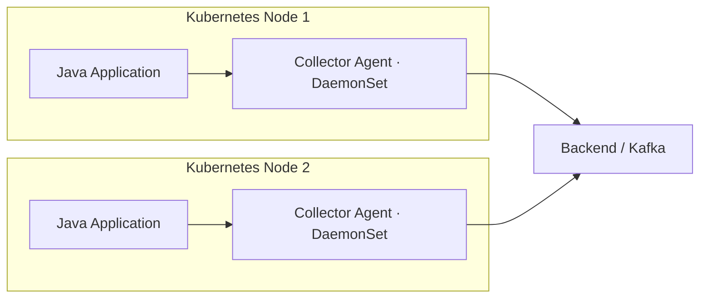
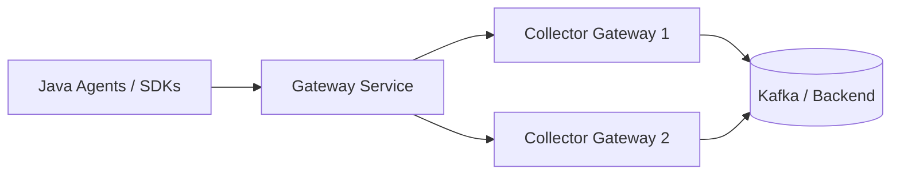
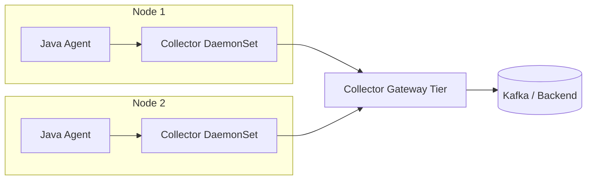
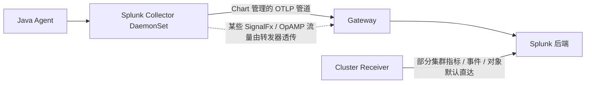
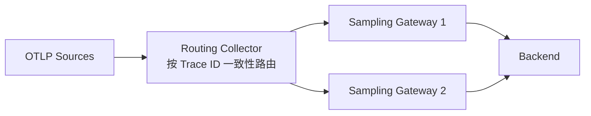
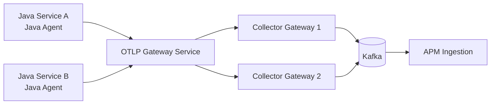

# OpenTelemetry Collector 部署架构调研：官方模式与 Splunk 实践

> 调研日期：2026-10-25  
> 范围：Collector 的**部署拓扑、Kubernetes 工作负载与数据路由**；不讨论 Java Agent 的字节码插桩架构。  
> 证据类型：官方文档与公开仓库配置静态核对；**未进行集群部署、压测或故障注入**。下文“建议”是工程推断，不应视为官方强制规范。

## 1. 研究问题与结论

问题：Splunk OTel Collector 在 Kubernetes 上的部署方式，是否与 OpenTelemetry 官方建议一致？对于 **Java Agent → Collector → Kafka** 的链路，该选择哪种部署模式？

**结论：**

1. **部署模式一致**：Splunk 采用 OpenTelemetry 官方描述的 Agent、Gateway、Agent-to-Gateway 模式，没有独立发明一套拓扑。官方模式是**可选部署方案**，不是必须同时部署两层。
2. **默认拓扑不相同于“两层 Collector”**：Splunk Helm Chart 默认启用节点 Agent（DaemonSet）与 Cluster Receiver（单副本 Deployment），**默认关闭 Gateway**。
3. **Splunk 有自己的部署编排与路由细节**：Chart 将集群级采集独立为 Cluster Receiver；启用 Gateway 时，Chart 管理的 Agent OTLP 数据通常进入 Gateway，但 Cluster Receiver 的部分数据默认仍直接发往后端。不能画成“所有数据必经 Gateway”。
4. **只接入 Java OTLP + Kafka 时**，可从 **Gateway-only** 开始，不必部署 DaemonSet。需要节点指标、容器日志、本地接入或中心化流量治理时，再选择 Agent 或 Agent-to-Gateway。
5. **Collector 是否可无状态扩容取决于 pipeline**：普通 OTLP 转发可水平扩容；Tail Sampling、部分状态化指标处理和抓取任务需要亲和性、分片或单实例协调。

## 2. 先区分“Java Agent”与“Collector Agent”

| 名称 | 运行位置 | 作用 |
|---|---|---|
| OpenTelemetry / Splunk Java Agent | Java 应用 JVM 内，通常用 `-javaagent` | 自动埋点、Context 传播、生成并发送遥测数据 |
| Collector Agent | 独立进程；Kubernetes 通常为每节点一个 DaemonSet Pod | 接收本地 OTLP、采集节点或容器数据、处理与转发 |
| Collector Gateway | 独立进程；Kubernetes 通常为多副本 Deployment | 集中 OTLP 接入、处理、数据路由、对外导出 |
| Splunk Cluster Receiver | Splunk Chart 的独立 Collector 工作负载 | 采集 Kubernetes API / 集群级指标与对象 |

Collector 是一个二进制程序，Agent 与 Gateway 是**部署角色**，并不是两套必然不同的核心程序。Collector 的 receiver / processor / exporter 组合由配置决定。

## 3. OpenTelemetry 官方部署模式

### 3.1 Agent-only：本地 Collector 直接向后端导出



- **部署**：每个 Node 一个 Collector DaemonSet；VM 场景通常为每台主机一个进程。
- **适用**：采集主机指标、容器日志、本地 OTLP 接入；处理逻辑较简单，允许节点 Collector 直接访问后端。
- **代价**：出口凭据、路由和处理逻辑分布于节点；后端连接数随节点数量增长。
- **边界**：DaemonSet 每节点一份不代表一个 Pod 一份；Java Agent 在各自 JVM 内运行。

### 3.2 Gateway-only：集中 OTLP 入口



- **部署**：Collector Gateway Deployment，多副本，Kubernetes Service 提供统一入口。
- **适用**：仅需接收应用 OTLP；数据处理和 Kafka 出口集中管理；无需 Collector 采集节点指标或容器文件日志。
- **代价**：应用跨网络向 Gateway 发送数据；网关故障、网络隔离或入口负载不均会影响整个采集面。
- **注意**：普通 Kubernetes Service 不保证 OTLP/gRPC **按每次请求均匀**分散，gRPC 长连接可能固定到少量后端；应实测分布或使用适当的 L7 负载均衡。

### 3.3 Agent-to-Gateway：节点采集与集中出口分离



- **部署**：DaemonSet Agent + Gateway Deployment。
- **适用**：同时需要本地日志/节点数据采集、统一出口、集中变换/过滤、独立扩容；大规模网络隔离场景。
- **代价**：多一跳传输、两个 Collector 运行层、更多队列与排障环节。
- **配置边界**：是否启用 Gateway 不决定采样正确性；Tail Sampling 的同 Trace 路由还需专门设计。

### 3.4 Sidecar：有条件的补充模式

Collector 还可以作为业务 Pod 的 Sidecar。适合需要 Pod 级隔离、独立本地配置或特定网络边界的工作负载；代价是每 Pod 资源与部署维护成本。**不要将 Sidecar 理解为官方要求的默认模式**。

官方参考：[部署模式总览](https://opentelemetry.io/docs/collector/deploy/) · [Agent](https://opentelemetry.io/docs/collector/deploy/agent/) · [Gateway](https://opentelemetry.io/docs/collector/deploy/gateway/) · [Agent-to-Gateway](https://opentelemetry.io/docs/collector/deploy/other/agent-to-gateway/)

## 4. Splunk OTel Collector Kubernetes 实现

### 4.1 Helm Chart 默认工作负载

公开 `values.yaml`（截至本次调研读取的 main 分支）：

```yaml
agent:
  enabled: true

clusterReceiver:
  enabled: true

gateway:
  enabled: false
```

| 组件 | Helm 参数 | 默认 | Kubernetes 角色 |
|---|---|---|---|
| Node Collector | `agent.enabled` | `true` | DaemonSet，每节点采集和转发 |
| Cluster Receiver | `clusterReceiver.enabled` | `true` | 独立单副本 Deployment |
| Gateway | `gateway.enabled` | `false` | 可选 Deployment / StatefulSet |
| Gateway 副本数 | `gateway.replicaCount` | `3`（仅在启用 Gateway 后生效） | 可水平扩容 |

因此 Splunk 的“默认安装”不等于“Agent + Gateway + Cluster Receiver 全部启用”。集群级指标的 Cluster Receiver 采用独立实例，主要是为了避免 DaemonSet 对同一集群重复抓取。

对应源码：[Splunk Helm values.yaml](https://github.com/signalfx/splunk-otel-collector-chart/blob/main/helm-charts/splunk-otel-collector/values.yaml)。

### 4.2 启用 Gateway 后的真实路由



**重要细节**：根据 Splunk Chart 的高级配置文档：

- Agent 使用 Chart 管理的 `otlp_grpc`、`otlp_http/entities` exporter 的数据，会经 Gateway OTLP receiver 及相应 pipeline 处理。
- Agent SignalFx 数据与部分管理流量经 Gateway 时可能是**透明转发**，**不会进入 Gateway 的 processor pipeline**。
- Cluster Receiver 的集群指标、事件、对象、实体等数据在默认配置下仍可能**直接发送到配置的后端**。
- 可以通过特定 exporter endpoint override 让部分 Cluster Receiver SignalFx 请求经 Gateway 的透明转发器，但这仍**不等于**经过 Gateway 的常规 OTLP processor。

所以，分析 Splunk 部署架构时必须同时看 **Kubernetes Workload 与实际 exporter endpoint**，不能仅依据 `gateway.enabled: true` 推断全量路由。

源码：[Gateway routing 官方说明](https://github.com/signalfx/splunk-otel-collector-chart/blob/main/docs/advanced-configuration.md#gateway-routing)。

### 4.3 Gateway-only 的官方示例

Splunk 官方示例包含以下开关：

```yaml
agent:
  enabled: false
clusterReceiver:
  enabled: false
gateway:
  enabled: true
  replicaCount: 1
```

上述配置仅用于说明**工作负载选择**，不是独立可运行的完整 `values.yaml`：生产安装仍需补充 Splunk 后端、凭据、资源与网络相关配置。

证据：[Splunk Gateway-only 示例](https://github.com/signalfx/splunk-otel-collector-chart/blob/main/examples/collector-gateway-only/collector-gateway-only-values.yaml)。

## 5. 官方与 Splunk 的部署差异

| 维度 | OpenTelemetry 官方模式 | Splunk Chart 实践 |
|---|---|---|
| DaemonSet Agent | 一种受支持拓扑 | 默认启用 |
| Gateway | 一种受支持拓扑 | 默认关闭，支持 Deployment / StatefulSet |
| Agent-to-Gateway | 受支持拓扑 | 启用 Gateway 后提供 Agent 到 Gateway 的预设路由 |
| 集群级采集 | 可独立部署 Collector 并限制采集副本 | `clusterReceiver` 独立单副本 Deployment |
| Helm / Workload 编排 | 官方 Chart / Operator 可用 | Splunk 自有 Helm Chart、默认管道和厂商端点 |
| 所有数据经 Gateway | 没有这样的通用要求 | **并非如此**；与数据通道、forwarder 和 endpoint 相关 |
| Kafka 出口 | Kafka Exporter 可按发行版使用 | 需确认当前二进制包含组件并自行配置，不是 Chart 默认目的地 |

**判断**：拓扑模式与上游基本一致，差异集中在 Helm 默认值、额外工作负载、厂商协议以及具体路由，并非 Collector 基础架构不同。

## 6. 扩容、状态与故障域

### 6.1 无状态 OTLP Gateway

对于常规 OTLP receiver → 处理 → Kafka exporter 的链路，多副本 Gateway 可以在 Service / LB 后水平扩展。上线前关注：

- `otelcol_receiver_accepted_spans` 与拒收量（按实际版本确认指标）。
- `otelcol_exporter_queue_size`、`otelcol_exporter_queue_capacity`、enqueue 失败以及发送失败。
- CPU、内存、GC、出口吞吐、Kafka broker 延迟与分区压力。
- gRPC 长连接分布；Kubernetes Service 后端副本是否实际承载均衡流量。

如果 Kafka 已到吞吐上限，**单纯加 Gateway 副本不会解决瓶颈**，可能进一步放大出口压力。队列也有容量上限，不代表持久可靠投递。

### 6.2 Tail Sampling 不可直接随机分流



Tail Sampling 在内存中缓存同一 Trace 的 Span 才能做决策。普通 Service 随机分配到多个 Gateway，可能让同一 Trace 被拆开，导致错误的采样决策。应通过上游提供的 `load_balancing` exporter（具体组件名/配置依所选版本核对）按 Trace ID 路由；扩缩容或成员发现变化期间仍需考虑路由变化。

部分聚合或 cumulative-to-delta 指标转换同样存在路由亲和性要求。**“多副本”不自动意味着“可无状态扩容”。**

官方参考：[Collector Scaling](https://opentelemetry.io/docs/collector/scaling/) · [Agent-to-Gateway](https://opentelemetry.io/docs/collector/deploy/other/agent-to-gateway/)。

## 7. Java Agent → Collector → Kafka 的建议拓扑

当前目标如果是采集 Java 应用 OTLP Trace、Metrics、Logs 并写入 Kafka，**先采用 Gateway-only**：



这与 Collector 官方部署模式兼容，也可选择上游 Collector 发行版，不必为了该拓扑自建发行版。

### 7.1 Gateway Collector 示例（示意配置）

如下是 **Collector Contrib 中具备相应组件的版本**可参考的管道结构，并非 Splunk Helm Chart 的完整 `values.yaml`：

```yaml
receivers:
  otlp:
    protocols:
      grpc:
        endpoint: 0.0.0.0:4317
      http:
        endpoint: 0.0.0.0:4318

processors:
  memory_limiter:
    check_interval: 1s
    limit_mib: 512
  batch: {}

exporters:
  kafka:
    brokers: ["kafka:9092"]
    traces:
      topic: otlp_spans
      encoding: otlp_proto
    metrics:
      topic: otlp_metrics
      encoding: otlp_proto
    logs:
      topic: otlp_logs
      encoding: otlp_proto

service:
  pipelines:
    traces:
      receivers: [otlp]
      processors: [memory_limiter, batch]
      exporters: [kafka]
    metrics:
      receivers: [otlp]
      processors: [memory_limiter, batch]
      exporters: [kafka]
    logs:
      receivers: [otlp]
      processors: [memory_limiter, batch]
      exporters: [kafka]
```

- Kafka Exporter 文档说明支持 traces、metrics、logs 的 OTLP Protobuf 编码；具体组件发布状态和配置字段随版本变化。
- 示例不包含 Kafka SASL/TLS、网络策略、持久队列、资源限制、Kafka Topic 创建及认证凭据，**不能直接作为生产配置**。
- Kafka Exporter 与 Collector 版本需要锁定并验证；采用 Splunk 发行版也应检查目标镜像的组件集合，而不是仅凭上游存在该 exporter 推断默认启用。

来源：[Kafka Exporter README](https://github.com/open-telemetry/opentelemetry-collector-contrib/blob/main/exporter/kafkaexporter/README.md)。

### 7.2 何时引入 DaemonSet Agent？

满足以下需求再考虑 Agent-to-Gateway：

1. 需要读取宿主机/节点指标、容器文件日志、Kubernetes Node 局部元数据。
2. 应用不应直接访问集中式 Gateway，要求本地 OTLP 接入和网络边界。
3. 集中出口凭据、管理出站链路与分层缓冲策略有明确运营收益。

如果还需要 Kubernetes API 级指标，可以用独立的 Cluster Collector 实例采集；**避免多副本无协调地重复抓取同一套集群级数据**。

## 8. 部署决策表

| 实际需求 | 建议模式 | 不选另一种模式的理由 |
|---|---|---|
| Java OTLP → Kafka，仅应用遥测 | Gateway-only | Node DaemonSet 没有明确收益 |
| Java OTLP + Node / 文件日志 | Agent-to-Gateway | 集中 Gateway 无法自然读取各节点日志文件 |
| 小规模 Node 采集、直接导出 | Agent-only | 可省去集中 Gateway |
| 集中 Tail Sampling | Agent / Routing Tier → Sampling Gateway | 需要按 Trace ID 亲和路由 |
| Kubernetes 集群指标 | 独立 Cluster Collector | 避免每节点重复采集全集群 |
| 特定 Pod 要求严格本地隔离 | Sidecar（按需） | 每 Pod 资源和配置成本更高 |

## 9. 尚需实验核对的事项

以下不是已完成的验证：

- [ ] 固定 Collector Contrib 版本并验证上述 Kafka 配置能启动。
- [ ] 测试 Gateway 2–3 副本下的 OTLP/gRPC 长连接负载分布。
- [ ] 断开 Kafka 验证队列满、重试、拒收、恢复后的丢失行为。
- [ ] 尾采样场景验证 Trace ID 路由和扩容时 Trace 完整性。
- [ ] 固定 Splunk Helm Chart 版本并执行 `helm template`，核对实际 DaemonSet、Deployment、Service 和各 pipeline endpoint。
- [ ] 对照业务流量评估 Collector 的 CPU、内存、网络与 Kafka 分区吞吐。

## 10. 一手资料

查阅日期：2026-10-25。源码链接默认指向 `main`，**并非固定版本快照**；复现实验时应记录 tag / commit SHA。

- [OTel：Deploy the Collector](https://opentelemetry.io/docs/collector/deploy/)
- [OTel：Agent-to-Gateway](https://opentelemetry.io/docs/collector/deploy/other/agent-to-gateway/)
- [OTel：Scaling the Collector](https://opentelemetry.io/docs/collector/scaling/)
- [Splunk：Helm Chart values.yaml](https://github.com/signalfx/splunk-otel-collector-chart/blob/main/helm-charts/splunk-otel-collector/values.yaml)
- [Splunk：Gateway routing / Advanced Configuration](https://github.com/signalfx/splunk-otel-collector-chart/blob/main/docs/advanced-configuration.md#gateway-routing)
- [Splunk：Gateway-only example](https://github.com/signalfx/splunk-otel-collector-chart/blob/main/examples/collector-gateway-only/collector-gateway-only-values.yaml)
- [OTel Collector Contrib：Kafka Exporter](https://github.com/open-telemetry/opentelemetry-collector-contrib/blob/main/exporter/kafkaexporter/README.md)
